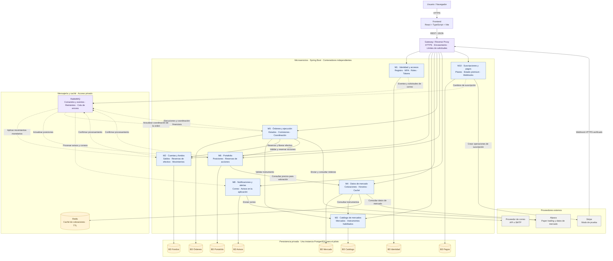

<div align="center">


[](https://dev.java)
[](https://spring.io/projects/spring-boot)
[](https://spring.io/projects/spring-cloud)
[](https://maven.apache.org)
[](https://www.postgresql.org)
[](https://redis.io)
[](https://www.rabbitmq.com)
[](https://alpaca.markets)
[](https://stripe.com)
[](https://resend.com)
[](https://docker.com)

</div>

> ### `Sobre el repositorio`

Backend de **Acciones UD**, la plataforma web de Day Trading para el mercado colombiano que desarrolla el equipo [Soltech](https://github.com/Soltech) en el Proyecto Final de Diseño Arquitectural de Software y Patrones (Universidad Distrital Francisco José de Caldas).

**Arquitectura**: 8 microservicios Spring Boot independientes, cada uno dueño de su base de datos, comunicados por REST (vía Gateway) y eventos asíncronos (RabbitMQ). Organización interna hexagonal (puertos y adaptadores) en cada servicio.

> ### `Stack`

1. **Java 21** + **Spring Boot 4.1** + **Spring Cloud 2025** (Gateway, Config, Discovery opcional).
2. **PostgreSQL** (una instancia, 8 bases lógicas con usuarios/permisos separados).
3. **Redis** (caché de cotizaciones en M4, sesiones en M1).
4. **RabbitMQ** (eventos de dominio: reservas, ejecuciones, notificaciones, suscripciones).
5. **Alpaca Paper Trading** (ejecución real simulada NYSE/NASDAQ, datos IEX).
6. **Stripe Test Mode** (suscripciones premium sin cobros reales).
7. **Resend** (correo transaccional: MFA, bienvenida, avisos de órdenes).
8. **Docker Compose** (levanta TODO: 8 servicios + Gateway + infraestructura).
9. **Maven multi-módulo** (parent POM + 10 submódulos: common, gateway, 8 microservicios).

> ### `Los 8 Microservicios`

| Servicio | Puerto | Base de datos | Dominio (dueño de datos) |
|----------|--------|---------------|--------------------------|
| **M1 Identidad y Accesos** | 8081 | `identidad_db` | Usuarios, roles, MFA, sesiones, tokens JWT |
| **M2 Cuentas y Fondos** | 8082 | `fondos_db` | Saldo contable, disponible, reservas, movimientos monetarios |
| **M3 Catálogo de Mercados** | 8083 | `catalogo_db` | Instrumentos, mercados, símbolos habilitados, metadatos |
| **M4 Datos de Mercado** | 8084 | `mercado_db` + Redis | Cotizaciones, feed Alpaca IEX, caché, horarios de mercado |
| **M5 Órdenes y Ejecución** | 8085 | `ordenes_db` | Ciclo de vida orden, coordinación M2/M6, envío Alpaca, conciliación |
| **M6 Portafolio** | 8086 | `portafolio_db` | Posiciones, disponibles/reservadas para venta, costo promedio, valoración |
| **M8 Notificaciones y Alertas** | 8088 | `avisos_db` | Correos (MFA, registro, órdenes), in-app, alertas de precio, Resend |
| **M10 Suscripciones y Pagos** | 8090 | `pagos_db` | Planes, suscripciones, Stripe test, webhooks, estado premium |

**Gateway** (puerto 8080) → punto de entrada único `/api/v1/**` con enrutamiento por prefijo.

> ### `Arquitectura`



**Reglas de coordinación**:
- **M5 coordina** la compra/venta: solicita reserva a M2 (fondos) y M6 (posiciones) → envía a Alpaca → confirma/cancela reservas → actualiza M6 → publica evento para M8.
- **Nada de FK entre servicios**. Acceso solo por contratos (REST síncrono o eventos async).
- **Transacciones locales** por servicio + **saga/outbox** para consistencia eventual.
- **Idempotencia** en comandos (claves `idempotencyKey`).
- **Moneda**: `BigDecimal` scale 2 `HALF_UP` (`MonetaryUtil` en `acciones-common`).

> ### `Estructura del proyecto`

```
backend/
├── pom.xml                          # Parent POM (10 módulos)
├── acciones-common/                 # Shared kernel: DTOs, eventos, excepciones, utilidades
├── gateway/                         # Spring Cloud Gateway
├── m1-identidad/
├── m2-cuentas-fondos/
├── m3-catalogo-mercados/
├── m4-datos-mercado/
├── m5-ordenes-ejecucion/
├── m6-portafolio/
├── m8-notificaciones/
├── m10-suscripciones-pagos/
├── docker-compose.yml               # 8 servicios + gateway + PG + Redis + RMQ
├── init-multi-db.sh                 # Crea 8 BDs en Postgres
├── CONTRIBUTING.md                  # Guía de contribución, flujo, contratos, DoD
└── README.md                        # Este archivo
```

Cada microservicio (arquitectura hexagonal interna):
```
src/main/java/co/edu/udistrital/acciones/<servicio>/
├── domain/           # Entidades, eventos de dominio, reglas puras (sin deps externas)
├── application/      # Casos de uso, handlers, puertos (interfaces in/out)
├── infrastructure/
│   ├── adapter/
│   │   ├── in/       # REST controllers, messaging consumers
│   │   └── out/      # JPA repositories, Redis, RabbitMQ publishers, clientes HTTP
│   └── config/       # Beans, security, OpenAPI
└── Application.java  # @SpringBootApplication
```

> ### `Puesta en marcha`

**Prerrequisitos**: Java 21, Maven 3.9+, Docker + Docker Compose.

```bash
# 1. Clonar y entrar
cd backend

# 2. Configurar variables de entorno (copiar y editar)
cp .env.example .env   # ver sección Variables de entorno

# 3. Levantar TODO (infra + 8 microservicios + gateway)
docker compose up -d

# 4. Verificar salud
curl http://localhost:8080/actuator/health   # Gateway
curl http://localhost:8081/actuator/health   # M1 Identidad
curl http://localhost:8082/actuator/health   # M2 Fondos
curl http://localhost:8083/actuator/health   # M3 Catálogo
curl http://localhost:8084/actuator/health   # M4 Datos
curl http://localhost:8085/actuator/health   # M5 Órdenes
curl http://localhost:8086/actuator/health   # M6 Portafolio
curl http://localhost:8088/actuator/health   # M8 Notificaciones
curl http://localhost:8090/actuator/health   # M10 Pagos

# 5. Ver logs de un servicio
docker compose logs -f m5-ordenes-ejecucion
```

> ### `Variables de entorno`

| Variable | Uso | Default local |
|----------|-----|---------------|
| `DB_HOST` / `DB_PORT` | PostgreSQL host/puerto | `localhost` / `5432` |
| `DB_USER` / `DB_PASSWORD` | Credenciales PG | `acciones_ud` / `acciones_ud` |
| `REDIS_HOST` / `REDIS_PORT` | Redis | `localhost` / `6379` |
| `RABBITMQ_HOST` / `RABBITMQ_PORT` | RabbitMQ | `localhost` / `5672` |
| `RABBITMQ_USER` / `RABBITMQ_PASSWORD` | Credenciales RMQ | `acciones_ud` / `acciones_ud` |
| `ALPACA_API_KEY` / `ALPACA_API_SECRET` | Alpaca Paper | **requerido** |
| `ALPACA_BASE_URL` | Endpoint Alpaca | `https://paper-api.alpaca.markets` |
| `RESEND_API_KEY` | Resend correo | **requerido para M8** |
| `STRIPE_API_KEY` / `STRIPE_WEBHOOK_SECRET` | Stripe Test | **requerido para M10** |
| `EUREKA_URL` | Service Discovery (opcional) | `http://localhost:8761/eureka` |

> ### `Desarrollo paralelo — frentes de trabajo`

| Frente | Servicios | Día 1 (contratos + simuladores) | Integración real necesita |
|--------|-----------|----------------------------------|---------------------------|
| **Acceso y comunicación** | M1 + M8 (mínimo) | ✅ Registro, tokens, MFA, envío correo mock | M8 envío real Resend |
| **Consulta de mercado** | M3 + M4 | ✅ Catálogo 10 símbolos, adaptador Alpaca WireMock | Credenciales Alpaca, símbolos M3 |
| **Operación financiera** (ruta crítica) | **M2 + M5 + M6** | ✅ Reservas, movimientos, estados con mocks M2/M6 | Contratos M2/M6 estables, Alpaca paper |
| **Frontend y plataforma** | Gateway, Docker, CI, pruebas | ✅ Rutas, healthchecks, pipelines | Servicios arriba |

**Asignación sugerida (equipo 5 personas)**:
- **Juan Carlos** (Líder backend): M5 coordinación + prueba integrada compra/venta.
- **Jamyson** (Backend/QA): M1 + M8 mínimo; apoyo ejecución/mercado.
- **Sebastián** (DB): Separación BDs, migraciones M2/M6, contratos.
- **Andrés** (Frontend): Catálogo, cotizaciones, formulario/seguimiento órdenes.
- **Paula** (Frontend/QA): Acceso, portafolio, avisos; evidencias y docs.

> ### `Contratos mínimos (definir antes de codificar)`

**M2 ↔ M5 (Fondos ↔ Órdenes)**
```
POST /api/v1/funds/reservations        { orderId, userId, amount, idempotencyKey } → 201 { reservationId }
POST /api/v1/funds/reservations/{id}/confirm   { executionId, amount } → 200
POST /api/v1/funds/reservations/{id}/release   { reason } → 200
GET  /api/v1/accounts/{userId}/balance         → 200 { available, reserved, total }
```

**M6 ↔ M5 (Portafolio ↔ Órdenes)**
```
POST /api/v1/positions/reservations   { orderId, userId, symbol, quantity, idempotencyKey } → 201 { reservationId }
POST /api/v1/positions/reservations/{id}/release { reason } → 200
POST /api/v1/positions/updates        { execution } → 200
GET  /api/v1/portfolio/{userId}       → 200 { positions[], totalValue }
```

**Eventos async (RabbitMQ)**
```
M1 → M8: UsuarioRegistrado { userId, email, tipo }
M5 → M8: OrdenCreada | OrdenEjecutada | OrdenCancelada | OrdenRechazada
M10→M1/M8: SuscripcionActivada | SuscripcionCancelada | PagoFallido
```

> ### `Pruebas y calidad`

- **Unitarias**: JUnit 5 + Mockito (dominio puro). Meta: **≥ 70% cobertura** en lógica crítica (JaCoCo).
- **Integración**: Testcontainers (Postgres, RabbitMQ, Redis reales) + WireMock (Alpaca, Stripe, Resend).
- **Contrato**: OpenAPI versionado en `docs/contracts/`.
- **E2E**: Playwright (frontend) + k6 (carga: 1500 VU, p95 ≤ 2s, confirmación ≤ 5s).
- **Seguridad**: OWASP ZAP en entorno público.
- **CI**: GitHub Actions → unitarias + integración + SonarQube en cada PR.

> ### `Definición de Hecho (DoD) por servicio`

- [ ] Contratos documentados y aprobados (OpenAPI/AsyncAPI).
- [ ] Migraciones Flyway/Liquibase versionadas.
- [ ] Pruebas unitarias ≥ 70% (lógica crítica).
- [ ] Pruebas de integración pasando (Testcontainers).
- [ ] Imagen Docker construible (`docker build`).
- [ ] Health/readiness endpoints (`/actuator/health`).
- [ ] Logs estructurados (JSON) + correlation-id.
- [ ] Métricas Prometheus expuestas.
- [ ] Documentación OpenAPI (`/v3/api-docs`).
- [ ] Desplegado en `dev` y humo pasando.

> ### `Flujo Git y GitHub`

- **Ramas**: `tipo/descripcion-kebab` (`feat/`, `fix/`, `chore/`, `docs/`).
- **Commits**: `tipo(scope): descripción en español` (`feat(m1): registro con MFA`).
- **PRs**: `feature/*` → **PR → `dev`** → **PR → `main`** (producción).
- **Descripción PR**: Qué / Por qué / Cómo probar / Checklist.
- **Labels** (tokyonight): feature #7aa2f7, fix #f7768e, docs #7dcfff, a11y #9ece6a, perf #e0af68, design #bb9af7, content #f7768e, infra #e0af68, dependencies #f38ba8, good first issue #73daca, blocked #565f89.
- **Milestones**: Sprint 1 - Acceso y Catálogo (2026-11-03), Sprint 2 - Operación Financiera Core (2026-11-17), Sprint 3 - Robustez y Reportes (2026-11-24), Sprint 4 - Entrega Final (2026-11-24).
- **CI verde obligatorio** antes de merge. **Merge commit** siempre (nunca squash/rebase/force-push).
- **Seguridad**: nunca commitear secretos/.env; revisar `git status`/`git diff` antes de stagear.

<div align="center">

**Soltech** · Acciones UD · 2026


</div># Test
